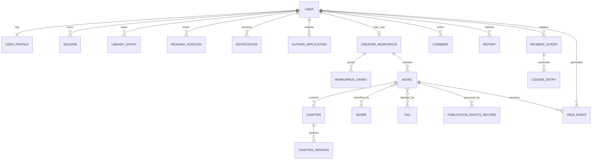

# Imperial Novel: Data Ownership and Entity Relationship Map

**Programme:** Phase 01N architecture
**Status:** Logical data architecture proposal; not an existing database schema
**Branch:** `architecture/phase-01n-master-route-registry`
**Purpose:** Establish data ownership, relationships, visibility, lifecycle, and migration requirements before schema changes

## 1. Ground rules

This is a logical model, not a claim that all listed entities or columns exist in the current D1 database. The actual schema must be inventoried from migrations and runtime queries before implementation.

- Every private or tenant-owned record has one authoritative owner or an explicitly defined platform owner.
- Foreign keys and ownership relationships are enforced in trusted server-side logic; client-provided IDs are references, not authority.
- Use stable internal IDs. Public slugs and route identifiers are not authorization credentials.
- Define lifecycle, retention, deletion, export, and audit behavior before adding a table.
- Store the minimum personal data needed for the feature. Avoid copying personal data into analytics, search indexes, logs, or event payloads.
- Cross-domain references must have documented deletion and failure behavior.

## 2. Ownership domains

| Domain | Logical owner | Primary privacy boundary |
|---|---|---|
| Identity | Individual user | Account and authentication secrets are private to the user and platform security boundary |
| Reader activity | Individual user | Private per-user activity |
| Creator workspace | Author account/workspace | Private drafts and creator operations |
| Publication catalog | Creator/workspace plus platform publication policy | Published records may be public; unpublished records remain private |
| Community | Individual contributor plus platform policy | Public contribution state plus private moderation evidence |
| Payments | User/account and platform financial ledger | Private financial records, audited operational access |
| Discovery and analytics | Platform, with source ownership preserved | Aggregated/minimized data; no unrestricted identity exposure |
| Integrations | Platform owner or explicitly scoped workspace | Credentials and provider tokens are confidential |
| Governance and security | Platform owner/security boundary | Restricted, audited, retention-controlled |

## 3. Logical entity catalogue

### 3.1 Identity and account

| Entity | Owner | Key relationships | Visibility | Lifecycle / retention notes |
|---|---|---|---|---|
| User | The user account; platform controls service metadata | One-to-many sessions, profile, preferences, activity, applications | Public profile projection only; account internals private | Deactivation, suspension, deletion request, legal retention exceptions |
| UserProfile | User | One-to-one user | Field-level public/private projection | User-editable; retain only necessary public fields |
| UserPreference | User | One-to-one or versioned per user | Private | Includes locale, theme, accessibility and notification choices |
| AuthCredential | User/security boundary | User; credential history | Never public or client-readable | Store password hashes, never plaintext; rotate/revoke safely |
| Session | User/security boundary | User; device/session metadata | User can inspect/revoke own sessions; secrets never returned | Expire and revoke; avoid logging tokens |
| RecoveryChallenge | User/security boundary | User; recovery attempt | Private and short-lived | Single-use, expiry, abuse controls; never expose recovery secret |
| ConsentRecord | User and platform | User; policy/version | Private operational record | Immutable evidence of consent version/time; retention policy required |

### 3.2 Reader experience

| Entity | Owner | Key relationships | Visibility | Lifecycle / retention notes |
|---|---|---|---|---|
| LibraryEntry | User | User + novel | Private to user | Remove independently of novel publication state |
| Bookmark | User | User + novel/chapter | Private to user | Validate chapter belongs to novel; support cleanup |
| ReadingPosition | User | User + novel + chapter | Private to user | High-write path; idempotent updates and retention controls |
| ReadingHistory | User | User + novel/chapter | Private to user | User-controlled clear/delete; minimize event detail |
| Follow | Follower user | Follower + target author/user/novel | Visibility policy; never reveal private follower lists by default | Unfollow and block semantics must be consistent |
| Notification | Recipient user | Recipient + event reference | Recipient only | Store minimal payload; expiry/read/archive policy |
| Rating | Creating user | User + novel | Public aggregate; identity visibility policy | One current rating per user/novel unless product explicitly allows history |
| Vote | Creating user | User + eligible target | Policy-defined aggregate | Enforce eligibility, uniqueness, time window and anti-abuse rules |

### 3.3 Publication and creator workspace

| Entity | Owner | Key relationships | Visibility | Lifecycle / retention notes |
|---|---|---|---|---|
| AuthorApplication | Applicant user | User; review case | Applicant sees own status; governance sees case | Submitted, under review, approved, rejected, withdrawn |
| CreatorWorkspace | Author account or approved workspace | Owner user; members/grants | Private | Workspace ownership transfer requires explicit audited workflow |
| WorkspaceGrant | Grantor/workspace owner | Workspace + grantee + scope | Private to grant parties and governance | Expiry/revocation; never allow self-escalation |
| Novel | Creator workspace | Author/workspace; genres, tags, chapters, assets | Draft private; published projection public | Draft, review, published, hidden, suspended, archived |
| Chapter | Creator workspace through parent novel | Novel; chapter assets; publication version | Draft private; published content public only if rights-cleared | Version history, scheduled publication, correction and takedown |
| ChapterVersion | Creator workspace | Chapter; author/editor actor | Private except published version | Immutable version snapshots where feasible; retention policy |
| Genre | Platform taxonomy | Novel associations | Public | Controlled taxonomy changes; stable canonical identifiers |
| Tag | Platform taxonomy or approved contributor suggestion | Novel associations | Public when approved | Normalize aliases; moderation and merge history |
| NovelGenre / NovelTag | Platform-managed relation | Novel + taxonomy item | Public only for published novel | Unique constraints; transactional updates |
| PublicationRightsRecord | Rights holder/creator plus platform governance | Novel/chapter; evidence references | Restricted; public rights summary only where appropriate | Record rights basis, territory, expiry, evidence location and takedown status |
| MediaAsset | Uploader/workspace or platform | Novel/chapter/user; object-storage key | Private until explicitly published | Quarantine, scan, validate, transform, retain/delete by policy |

### 3.4 Community and trust

| Entity | Owner | Key relationships | Visibility | Lifecycle / retention notes |
|---|---|---|---|---|
| Comment | Creating user | Novel/chapter/thread parent | Public if approved; hidden states restricted | Edit/delete policy; preserve moderation evidence separately |
| CommentReaction | Acting user | User + comment + reaction type | Aggregate/public policy | Unique per user/comment/reaction; idempotent |
| Report | Reporting user | Reporter + target resource | Reporter and governance only, limited status projection | Protect reporter identity; evidence retention policy |
| ModerationCase | Platform governance | Report(s), target, assigned scope | Restricted | Case state, reason, evidence references, decision and appeal |
| Block | Blocking user | Blocker + blocked user | Private | Enforce across discovery and interaction surfaces; reversible |
| Mute | Muting user | Muter + muted user/content | Private | Personalized suppression; does not imply moderation action |

### 3.5 Payments and monetization

| Entity | Owner | Key relationships | Visibility | Lifecycle / retention notes |
|---|---|---|---|---|
| TicketPackage | Platform | Package version and price | Public | Version prices; never silently rewrite historical purchase terms |
| PaymentIntent | User and platform payment workflow | User; provider reference; package | User sees own intent; restricted operational view | Pending, confirmed, failed, expired, disputed; reconcile callbacks |
| LedgerEntry | Platform financial ledger, attributed to account | User/account; payment/refund/adjustment reference | User sees own entries; owner audited access | Append-only accounting events; corrections via compensating entries |
| PaymentWebhookEvent | Platform integration boundary | Provider event ID; payment intent | Restricted | Verify signature, deduplicate, store minimal payload, replay safely |
| RefundOrAdjustment | Platform owner-controlled workflow | Ledger entry; payment intent; actor | Restricted and audited | Idempotent, reason-coded, reconciliation required |

### 3.6 Discovery, real-time and analytics

| Entity | Owner | Key relationships | Visibility | Lifecycle / retention notes |
|---|---|---|---|---|
| ViewEvent | Platform event pipeline; source content owner preserved | Content ID; pseudonymous/session context where justified | Never expose raw event stream publicly | Deduplicate, minimize, aggregate and expire raw events |
| EngagementEvent | Platform event pipeline | Content + action + actor pseudonym | Public only as safe aggregate | Avoid trusting client counters; anti-abuse and deduplication |
| AnalyticsAggregate | Platform or creator workspace | Time bucket + content/workspace | Author sees own-work aggregate only | Recompute/version aggregates; small-cohort privacy controls |
| SearchDocument | Platform index derived from source records | Novel/author/taxonomy IDs | Only index public eligible fields | Delete/update promptly when source becomes private or removed |
| RecommendationSnapshot | Platform per user or anonymous context | User/context + eligible content IDs | Private/personalized | Expire, rebuild and honor blocks, locale, rights and safety |
| RankingSnapshot | Platform | Ranking dimension + time window | Public if published | Versioned calculation and anti-manipulation controls |

### 3.7 Integrations, operations and governance

| Entity | Owner | Key relationships | Visibility | Lifecycle / retention notes |
|---|---|---|---|---|
| ProviderConnection | Platform owner or explicitly approved workspace | Provider; owner/workspace | Restricted | Disabled by default; explicit scopes, revocation and health state |
| ProviderSecretReference | Platform security boundary | Secret manager reference; provider connection | Secret value never in app DB or logs | Rotation, expiry and revocation; no secret read-back |
| ImportJob | Platform or authorized workspace | Provider connection; metadata candidates | Restricted to authorized operators | Metadata-only by default; rights gate before ingestion |
| ImportCandidate | Platform catalog stewardship | External metadata; possible duplicate | Restricted until reviewed | Provenance, source URL, confidence, review decision |
| AuditEvent | Platform security boundary | Actor/service + action + target | Restricted | Append-only where feasible; minimized payload; retention policy |
| SecurityAlert | Platform security boundary | Detection rule; affected principal/resource | Restricted | Acknowledge, investigate, resolve; preserve evidence |
| FeatureFlag | Platform owner | Feature/environment | Operationally restricted | Change audit, safe defaults, emergency kill switch |
| SystemSetting | Platform owner | Setting key/version | Restricted; public projection only | Typed validation, change history and rollback |

## 4. Relationship map

Conceptual high-level relationships (cardinality is logical and must be reconciled against the actual schema):

The diagram is illustrative. Some relationships may be optional, many-to-many, mediated by workspace membership, or implemented through join tables. The schema audit must determine actual cardinalities and nullability.

## 5. Keys, constraints and indexing principles

- Use primary keys that are stable, non-sequential externally where enumeration risk matters; opaque IDs do not replace authorization.
- Add foreign keys and unique constraints for ownership-sensitive relationships wherever supported and operationally safe.
- Add composite indexes matching real query patterns, commonly `(owner_user_id, updated_at)`, `(workspace_id, status, updated_at)`, `(novel_id, publication_status, chapter_number)`, and unique `(user_id, novel_id)` for one-rating-per-user rules.
- Use uniqueness constraints for provider event IDs, idempotency keys, membership/grant tuples, reaction tuples, and payment reconciliation identifiers.
- Keep canonical IDs distinct from slugs, display names, locale labels and provider identifiers.
- Avoid unbounded JSON blobs for authorization-critical state. Store queryable, validated fields and version policy documents.
- Never expose storage object keys, internal database IDs, or provider secrets as proof of access.
- Query plans and indexes must be validated using real representative data and `EXPLAIN QUERY PLAN` or the applicable database tooling.

## 6. Data classification and storage

| Classification | Examples | Storage/access requirement |
|---|---|---|
| Public | Published novel metadata, public author bio, published chapters | Public projection only; cache only after rights and publication checks |
| Personal | Email, preferences, library, history, reading position | Private; least-privilege access; no shared cache |
| Sensitive personal | Authentication recovery data, private reports, payment identifiers | Strong access restrictions, minimization, encryption where appropriate, audited access |
| Creator confidential | Drafts, unpublished chapters, contracts, rights evidence | Workspace isolation; private object storage; explicit collaborator grants |
| Financial/security | Ledger, payment events, audit events, security alerts | Restricted operational boundary; integrity and retention controls |
| Operational secrets | Provider tokens, signing keys, API credentials | Secret manager/binding only; never ordinary DB rows, browser payloads or logs |

## 7. Data lifecycle contract

Every entity must define:

1. Creation authority and required validation.
2. Authoritative owner and ownership-transfer rules.
3. Read/write policy and field-level visibility.
4. State machine and allowed transitions.
5. Retention period and legal/financial exceptions.
6. User export and deletion behavior where applicable.
7. Audit events and evidence retention.
8. Cache/index/derived-data invalidation behavior.
9. Backup and restore requirements.
10. Migration and rollback behavior.

Account deletion must not blindly cascade through legally required financial records, security evidence, or content rights records. Define pseudonymization, retention, takedown and deletion behavior per entity with legal review. Conversely, derived search documents, recommendations, cached profile data and user activity must not remain indefinitely after a valid deletion or privacy request.

## 8. Event and derived-data ownership

Source-of-truth records remain authoritative. Search documents, ranking snapshots, recommendation snapshots, analytics aggregates, notification deliveries and cache entries are derived data. Each derived record must identify its source/version, refresh strategy, expiry, and deletion/invalidation behavior.

Events should contain identifiers and minimal necessary attributes, not full user profiles, credentials, private chapter bodies, or payment secrets. Event consumers must re-check eligibility and authorization before performing sensitive actions.

## 9. Existing-schema reconciliation checklist

Before any migration, inspect all current SQL migrations, D1 tables, indexes, constraints, query helpers and API handlers. Produce a field-level inventory with:

- actual table and column name, type, nullability, default, primary/foreign key
- current data owner and whether ownership can be proven
- unique/index constraints and known query patterns
- every API writer and reader
- current authorization check and gaps
- lifecycle state and existing retention/deletion behavior
- migration/backfill requirement and rollback strategy

Flag orphaned records, duplicate identities, missing ownership, invalid foreign references, inconsistent status values, and unbounded free-text or JSON fields. Do not invent ownership during backfill. Quarantine ambiguous records for owner review.

## 10. Migration sequence

1. Inventory and snapshot the existing D1 schema and representative data shape.
2. Map existing `users`, novels, chapters, comments, ratings, reports, tickets, payment and activity tables to these logical entities.
3. Identify mismatches, missing tables, denormalized fields and duplicate concepts.
4. Define additive migrations first; avoid destructive renames or drops in early stages.
5. Backfill owner/workspace references in batches with reconciliation counts.
6. Add indexes and constraints after data validation; test migration duration and lock/contention behavior.
7. Add dual-read or shadow validation only where it is safe and time-bounded.
8. Switch application reads/writes behind feature flags with metrics and rollback.
9. Verify data counts, ownership invariants, foreign-key integrity, route behavior and authorization tests.
10. Remove legacy structures only after a separately approved cleanup release and restorable backup.

## 11. Required integrity and privacy tests

- No user-owned row can be returned without verifying the authenticated owner or a valid scoped grant.
- Every chapter belongs to exactly one valid novel; chapter routes cannot cross novel boundaries.
- A workspace cannot contain a novel whose owner/workspace relation is inconsistent.
- Public search and catalog indexes exclude drafts, suspended content, rights-blocked content and private fields.
- A publication status change invalidates affected caches, indexes, rankings and recommendation snapshots.
- User deletion/export covers source records and all derived data within the documented policy.
- Payment callbacks are signature-verified, idempotent and linked to one canonical payment intent.
- Ledger corrections use compensating entries rather than silently rewriting historical accounting events.
- Media objects cannot be fetched from private storage without a valid authorized delivery path.
- Cross-user, cross-author and cross-workspace relationship tests fail closed.
- Backups restore with referential integrity and ownership invariants intact.

## 12. Completion gates

- [ ] Actual D1 schema inventory is complete and source-linked.
- [ ] Every table and object has an owner, visibility classification and lifecycle contract.
- [ ] All ownership relationships and foreign keys are reconciled.
- [ ] No ambiguous or orphaned records are silently assigned to a user.
- [ ] Query/index design is based on measured access patterns.
- [ ] Derived data has versioning, expiry and invalidation rules.
- [ ] Retention, export, deletion and legal exceptions are defined.
- [ ] Migration dry run, rollback and backup restore are successful.
- [ ] Data-integrity and authorization test suites pass.

**Current phase result:** Logical ownership and relationship model drafted. Existing D1 schema reconciliation, migrations, implementation, data protection testing and production verification remain outstanding.

## 13. Open decisions requiring evidence

- Exact current D1 table and column inventory.
- Existing object-storage provider and access-control configuration.
- Actual retention periods and applicable legal obligations.
- Whether creator workspaces are strictly one-author or support future collaboration.
- Whether reading history is retained indefinitely, user-controlled, or time-limited.
- Which public profile fields are currently exposed and what consent model governs them.

---

**Next architecture dependency:** define cross-domain dependencies, event contracts, queue semantics, failure isolation and recovery behavior before implementation.