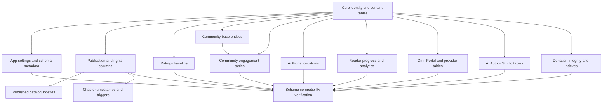

# Imperial Novel | Phase 01O.2: Runtime DDL Ownership & Migration Dependency Map

**Review date:** 2026-11-01  
**Repository ref:** `architecture/phase-01m-screen-blueprint`  
**Status:** Static source inventory; no migration execution.

## 1. Purpose

This document maps the runtime DDL owners discovered in the audited source and the numbered migrations that overlap or depend on them. It is not a complete repository-wide generated schema inventory. Files not yet inspected are explicitly marked unresolved.

## 2. Runtime DDL inventory

| Owner | Observed objects/changes | Current call pattern | Target owner |
|---|---|---|---|
| `ensureCoreSchema` in `src/index.js` | Core users/sessions/novels/chapters/taxonomy, unlocks, bookmarks/history, donations, connectors, comments, requests, audit logs, ticket ledger, follows, library, ratings, comment reports, reports, notifications, agents, settings, core indexes | Called before most API routing; marker fast-path `16.64.0` | Foundational numbered migrations + explicit seed job |
| `ensurePublishingSchema` | Novel ownership/publication/rights/review columns; chapter publication/update columns; chapter views; publication indexes/triggers | Called by core bootstrap and selected request paths | Dedicated publication/rights migrations |
| `ensureRuntimeFeatureSchema` in `src/runtime-feature-schema.mjs` | Auth rate limits, comment likes/reports, novel reactions, request votes; comment parent/edit columns; cleanup and marker | Called after core schema on API requests | Reviewed feature migration(s) |
| `ensureEngagementSchema` | Comment likes, novel reactions, related indexes | Called by engagement endpoints | Same canonical engagement migration as feature table definitions |
| `ensureViewAnalyticsSchema` | Daily novel/chapter view aggregates and indexes | Called during view recording | Analytics migrations |
| `ensureAuthorAISchema` | AI author projects, chapter jobs, generation runs, provider benchmarks, publish policies | Called during core bootstrap | AI domain migrations |
| `ensureCommunityTaxonomySchema` | Taxonomy submissions | Called during core bootstrap | Community taxonomy migration |
| `ensureOmniTables` | Connector columns; connector events, import jobs, recommendations, connector authorization requests and indexes | Called from OmniPortal paths and seed routines | OmniPortal/provider migrations |
| `createDonationReferenceIndexEnsurer` in `src/donation-reference-index.mjs` | Unique normalized index on `donations(LOWER(TRIM(reference_id)))` | Invoked from donation-related path | Donation integrity migration after duplicate preflight |
| `seedTaxonomy`, `ensureAgents`, `seedOmni` | Reference vocabulary, agent registry, connector registry rows | Part of runtime initialization/seed paths | Explicit idempotent seed command/job, separate from DDL |

The table is based on the inspected files and visible call sites. A complete scan of all source modules is still required before declaring this list exhaustive.

## 3. Specific ownership conflicts

### 3.1 Publication schema vs migrations 0010 and 0013
The publishing helper adds `novels.publication_status` and `chapters.publication_status`. Migration 0004 adds the novel column before 0010 indexes it. Migration 0005 adds the chapter column before 0013 uses it in a trigger and index. The numbered dependency order is present in the inspected chain; the problem is duplicated runtime ownership and lack of a proven clean/upgrade test, not a demonstrated missing publication prerequisite.

### 3.2 Chapter updated_at overlap
The publishing helper adds and backfills chapters.updated_at, then creates update triggers and indexes. Migration 0013 also adds updated_at, backfills it and creates triggers/indexes. Both are not safe to run independently against an already-upgraded schema without compatibility handling; migration ownership must be singular. Running both without a carefully designed transition can fail on duplicate columns or leave inconsistent trigger definitions. One canonical migration must own the column, backfill, trigger and index.

### 3.3 Ratings
Migration 0003 creates ratings with CHECK 1–5. Runtime core bootstrap independently creates ratings with CHECK 1–10. Migration 0017 rebuilds the migration baseline by copying rows, dropping the original and renaming the new table. Thus a database initialized through runtime core may already have the target constraint while a database initialized through migrations expects the 0017 transition. Define one canonical baseline and an upgrade-safe path; never apply 0017 blindly without checking the actual table and data. Never apply 0017 blindly to a database where ratings does not exist.

### 3.4 Community engagement
Runtime feature helper and engagement helper both create overlapping tables/indexes with differing constraints. The candidate 0012 migration adds foreign keys, uniqueness and legacy cleanup. A single canonical definition must be selected; runtime helper definitions cannot remain a second authority.

### 3.5 OmniPortal
`ensureOmniTables` adds columns one by one, catches all ALTER errors, then batches table/index DDL and suppresses batch failure. This can conceal partial schema state. Replace with explicit migrations and a readiness check that names missing objects. Do not retain broad catch-and-continue DDL behavior.

### 3.6 Donation normalized reference index
The donation helper creates a unique expression index over normalized reference IDs. Existing duplicates may cause index creation to fail. Before migration, identify duplicates using the same normalization expression and define a safe manual reconciliation process. Do not silently delete payment references or merge financial events.

## 4. Migration dependency graph

The following is a logical dependency graph, not a finalized filename ordering:

## 5. Schema marker policy

Current markers observed:
- `core_schema_version=16.64.0`;
- `runtime_feature_schema_version=1`.

These markers do not prove that every expected table/column/index exists. A partial DDL failure, a previous code version, or a branch-specific migration can leave marker and schema state out of sync.

Target policy:
1. D1 migration history is the ordered deployment record.
2. A schema compatibility report checks required objects and constraints.
3. Runtime version compatibility is explicit (minimum/maximum supported schema).
4. Markers are written only after all migration statements and verification succeed.
5. A missing object with a current marker is a readiness failure, not a reason for runtime auto-repair.
6. A marker must not be advanced if any migration statement failed.

## 6. Safe adoption strategy

### Stage A: Inventory and fixtures
- Freeze source SHA.
- Capture every numbered migration filename and checksum.
- Extract runtime DDL from all source modules, including helper modules.
- Generate expected schema object inventory.
- Construct clean and historic upgrade fixtures.

### Stage B: Canonical migration design
- Decide which existing migrations are already released and immutable.
- Add new forward-only migrations for missing objects.
- Resolve migration 0012 candidate and feature schema differences.
- Reconcile publication columns, chapter timestamp ownership and ratings baseline.
- Reconcile OmniPortal, AI, analytics, taxonomy and donation objects.
- Separate schema DDL from reference data and demo content seeding.

### Stage C: Test
- Run clean SQLite migration chain.
- Run supported historic upgrade paths.
- Compare `sqlite_master`, `PRAGMA table_info`, `PRAGMA index_list`, `PRAGMA foreign_key_list` and trigger definitions.
- Verify all application SQL query paths.
- Test idempotency, interruption and retry.
- Test D1 behavior on a disposable database.

### Stage D: Runtime transition
- Release additive migrations first.
- Deploy code that can operate on both old and new schema only where compatibility is proven.
- Verify schema readiness.
- Remove runtime DDL helpers in a later release.
- Retain a clear maintenance response if an environment has an unsupported schema.

## 7. Explicit unresolved items

- Complete migration file inventory beyond the inspected 0001, 0009–0018 subset.
- Full DDL in every AI helper statement and any external source module.
- Complete donation, analytics, OmniPortal, taxonomy and agent schema constraints.
- Actual D1 migration history and production schema.
- Whether migrations 0013, 0017 and later migrations have already been applied in any environment.
- Whether the candidate migration 0012 is intended to be part of the production history.
- Exact clean-install CI test command and whether it currently exists.
- Whether the runtime demo seeding path is active in the intended production source.

## 8. Acceptance criteria

1. Every DDL statement has exactly one canonical migration owner.
2. No request handler creates or alters domain schema.
3. Every migration dependency is satisfied in lexical order.
4. Clean install succeeds using numbered migrations alone.
5. Supported upgrade paths preserve all required records.
6. Existing migration checksums remain unchanged.
7. Schema markers and migration history agree with actual objects.
8. Runtime compatibility checks do not mutate schema.
9. All application queries pass against the migrated fixture.
10. D1 fixture verification passes before any production rollout.

No code, SQL, database or deployment was changed.
