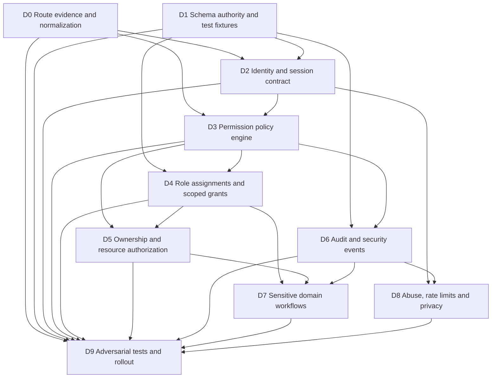

# Imperial Novel | Phase 01P.4: Security Implementation Dependency Map

**Branch:** `architecture/phase-01m-screen-blueprint`  
**Scope:** Architecture and sequencing only. This document does not authorize implementation or production changes.  
**Evidence baseline:** Phase 01P role model, API permission matrix, route inventory and security test matrix; Phase 01O database reconciliation; inspected `src/index.js` source SHA `13874ee0fde4e31e04a652c5169776c3b6f95c38`.

## 1. Executive decision

Security implementation must proceed in dependency order, not by adding role checks randomly to individual routes. The recommended sequence is:

1. Freeze the source-of-truth contracts and inventory.
2. Establish reproducible schema and test fixtures.
3. Build identity/session and policy foundations.
4. Introduce scoped permission assignments and ownership enforcement.
5. Protect high-risk workflows (publishing, rights, moderation, finance, providers, agents).
6. Add audit, abuse controls and operational observability.
7. Run adversarial tests and release gates.
8. Roll out behind compatibility controls, then remove legacy guards only after parity is proven.

**No implementation is authorized by this plan.** The current four-role model remains the deployed behavior until a separately reviewed implementation is approved.

## 2. Dependency layers

| Layer | Foundation | Depends on | Produces | Can proceed independently? |
|---|---|---|---|---|
| D0 | Evidence baseline and route normalization | Current source and Phase 01P.2 inventory | Stable route-operation registry with source evidence | Yes; first |
| D1 | Database test fixtures and schema authority | Phase 01O clean-install plan; migration inventory | Reproducible empty/legacy D1 fixtures and schema assertions | Yes, in parallel with D0 |
| D2 | Identity and session contract | D0, D1 | Account-state policy, session lifecycle, revocation and step-up contract | Contract work can proceed; code depends on D1 |
| D3 | Permission policy engine | D0, D2 | Deny-by-default permission evaluation and policy tests | Contract can proceed; code depends on D2 |
| D4 | Role assignments and scoped grants | D1, D3 | Roles, permissions, resource scopes, approval and audit schema | Requires D1 and D3 |
| D5 | Ownership/resource authorization | D0, D3, D4 | Owner checks for author projects, novels, chapters and personal data | Requires D3/D4 |
| D6 | Audit and security event foundation | D1, D3 | Append-only security events, correlation IDs, fail-closed rules | Schema requires D1; policy requires D3 |
| D7 | Domain-specific sensitive workflows | D4, D5, D6 | Publishing, rights, moderation, finance, connector and agent boundaries | Requires all foundational layers |
| D8 | Rate limiting, abuse and privacy controls | D0, D2, D6 | Route-class limits, cache/privacy rules, anomaly signals | Can start as contract work; implementation depends on D2/D6 |
| D9 | Adversarial verification and rollout | D0-D8 | Test evidence, compatibility report, release decision | Requires implemented layers and isolated fixtures |

## 3. Dependency graph

## 4. Work packages and acceptance gates

### WP-0: Normalize the API operation registry
**Inputs:** Phase 01P.2 source-line inventory; Phase 01P.1 permission/ownership matrix; current Worker dispatcher and imported helper modules.

**Work:**
- Expand every exact, prefix and dynamic path predicate into operation rows by HTTP method.
- Resolve default method behavior, path parameters, nested conditions and helper-dispatched operations.
- Inspect each helper's authentication, ownership, side effects, audit, rate limit and error handling.
- Record source SHA, line range and confidence for each row.
- Mark unresolved dispatch branches explicitly; do not label the registry exhaustive until all paths reconcile.

**Gate G0:** Every discovered API dispatch branch is either mapped to one or more operations or listed as an unresolved evidence gap. No inferred route is presented as observed.

### WP-1: Schema and fixture foundation
**Inputs:** Phase 01O.1 through 01O.4; full migration inventory; candidate missing 0012 evidence.

**Work:**
- Resolve canonical schema ownership and runtime DDL duplication.
- Decide and review the missing 0012 artifact; do not copy the divergent candidate without reviewing cleanup/archive behavior and data retention.
- Build empty-database and representative legacy fixtures.
- Assert migration order, indexes, foreign keys, constraints, data preservation and schema equivalence.
- Preserve rating contract as integer 1–10 and verify all write/read/aggregate paths consistently.

**Gate G1:** Clean install and legacy upgrade pass in isolated test databases; schema checks pass; no production D1 has been touched.

### WP-2: Identity and session lifecycle
**Inputs:** G0, G1; existing session and authentication handlers.

**Work:**
- Define account states separately from roles.
- Define session creation, rotation, expiry, revocation, logout, stale-session handling and step-up requirements.
- Define verification and recovery journeys without claiming they exist in current code.
- Define cookie, CSRF, origin and cache behavior.
- Preserve backward compatibility for existing sessions during a bounded migration window.

**Gate G2:** Session lifecycle and account-state tests pass, including stale/revoked session denial and session fixation protections.

### WP-3: Policy engine and permission vocabulary
**Inputs:** G0, G2.

**Work:**
- Implement a pure, deterministic policy contract before wiring routes.
- Resolve actor, account state, role grants, resource scope, action, contextual conditions and approval requirements.
- Deny by default; distinguish unauthenticated, forbidden, not found and restricted states without leaking resources.
- Avoid treating role names as permissions.
- Add policy decision reason codes suitable for audit without leaking sensitive details.

**Gate G3:** Table-driven policy tests pass for all role, account-state and scope combinations. Unknown permission/action is denied.

### WP-4: Scoped roles, grants and separation of duties
**Inputs:** G1, G3.

**Work:**
- Add normalized role, permission, role-permission and scoped assignment records only after schema tests pass.
- Separate account state from role.
- Make high-risk grants approval-based; prevent self-grant and last-administrator lockout.
- Define resource scopes: own resource, assigned resource, category/queue, global.
- Require independent approver for finance, rights, security administration and emergency access.
- Define expiry/revocation and migration from current `user`, `author`, `moderator`, `admin` roles.

**Gate G4:** Grant/revoke, expiry, conflict-of-interest, dual-approval and legacy mapping tests pass.

### WP-5: Ownership and object-level authorization
**Inputs:** G0, G3, G4.

**Work:**
- Apply a shared ownership policy to author projects, novels, chapters, drafts, analytics and collaborators.
- Bind personal library, history, bookmarks, progress, follows, notifications, jobs and ledgers to the authenticated subject.
- Validate parent-child relationships for chapter/novel and other nested IDs.
- Avoid request-supplied owner IDs as authorization evidence.
- Use consistent 404/403 policy to avoid resource enumeration.

**Gate G5:** Cross-account IDOR suite passes for every mapped operation that accepts a resource identifier.

### WP-6: Audit and security event foundation
**Inputs:** G1, G3.

**Work:**
- Define event schema: actor, effective subject, action, resource type/id, decision, reason code, correlation ID, timestamp, before/after digest where appropriate.
- Protect audit records from ordinary staff edits/deletes.
- Define fail-closed versus recoverable behavior for each critical mutation.
- Make state change and audit record atomic where the storage model supports it.
- Never place passwords, tokens, provider secrets or full sensitive content in audit payloads.

**Gate G6:** Critical operations cannot silently succeed without required audit evidence; audit failure behavior is tested.

### WP-7: Sensitive domain workflows
**Inputs:** G4, G5, G6.

| Domain | Required boundary | Minimum approval rule |
|---|---|---|
| Publishing | Author submits; independent publishing reviewer decides; rights evidence attached | Author cannot approve own work |
| Rights/providers | Provider operation separated from rights decision | Requester cannot approve own authorization |
| Moderation | Queue/resource scoped moderator grants | Moderators cannot access finance or security administration by default |
| Finance | Separate finance operator and approver; immutable ledger | No self-approval; idempotent state transition |
| Tickets | Every balance change has ledger counterpart and reason | Manual credit requires independent approval |
| AI agents | Explicit capability allowlist, scoped service identity and bounded actions | Agent cannot grant itself roles, approve rights or move money |
| Security operations | Sensitive settings require step-up and independent review | Emergency access expires and is audited |

**Gate G7:** Domain-specific positive, negative, cross-scope, replay, concurrency and audit tests pass.

### WP-8: Abuse, privacy and real-time controls
**Inputs:** G0, G2, G6.

**Work:**
- Define rate limits by route class and actor/resource, not only by IP.
- Add idempotency and replay protection to money, unlock, request and review operations.
- Define cache-control and private-data boundaries.
- Define real-time event contracts separately from polling; presence must be opt-in and privacy bounded.
- Distinguish observed metrics from estimates; unknown metrics must not display as zero.
- Apply privacy thresholds to public aggregate analytics.

**Gate G8:** Abuse, replay, cache isolation, rate-limit and privacy tests pass.

### WP-9: Security verification and release
**Inputs:** G0-G8.

**Work:**
- Execute the Phase 01P.3 matrix against isolated fixtures.
- Run clean-install and legacy-upgrade tests.
- Verify every API route has an explicit policy decision and negative test.
- Produce a release evidence bundle with source SHA, migration SHA, test results and rollback plan.
- Deploy first to a non-production environment only after explicit authorization; production requires separate confirmation.

**Gate G9:** No P0 failures, no skipped P0 tests, no unexplained schema drift, no unresolved critical ownership paths, and an approved rollback plan.

## 5. Work that can happen in parallel

| Parallel stream | Safe while another stream proceeds? | Boundary |
|---|---|---|
| Route normalization and schema test planning | Yes | Evidence/docs only |
| UX permission affordance design | Yes | UI must not imply authorization; server remains authority |
| Security event taxonomy | Yes | No runtime logging changes before schema/policy review |
| Rate-limit threat model | Yes | No production throttling changes |
| Localization of permission/error copy | Yes | Copy must follow approved policy semantics |
| Production source observation | Yes, read-only | No data changes, secret reads or deploys |

## 6. Work that must not be parallelized prematurely

- Role migration before policy and schema tests.
- Route guard rewrites before complete operation inventory.
- Finance workflows before ledger and idempotency design.
- Provider activation before rights evidence and SSRF controls.
- Agent orchestration before service identity and capability boundaries.
- Production migration before clean-install and legacy-upgrade gates.
- UI permission hiding as a substitute for API authorization.
- Replacing current route architecture before compatibility and rollback plans.

## 7. Compatibility and rollout strategy

1. Introduce policy evaluation in shadow mode only in an isolated/staging environment; compare decisions with legacy guards.
2. Resolve every allow/deny mismatch and record evidence.
3. Enforce policy on a narrow low-risk route cohort first.
4. Expand by domain only after route-specific tests pass.
5. Keep legacy compatibility adapters until all consumers are migrated.
6. Remove old guards only after parity, observability and rollback gates pass.
7. Never use a branch-wide merge as a substitute for selective reviewed integration.

No shadow mode or staged rollout is currently implemented by this document.

## 8. Current readiness ledger

| Item | State | Evidence |
|---|---|---|
| Role/permission target model | Specified | Phase 01P |
| API-to-permission high-level map | Specified, not exhaustive | Phase 01P.1 |
| Source-line route inventory | Partial | Phase 01P.2 |
| Authorization/IDOR test matrix | Specified, unexecuted | Phase 01P.3 |
| Full normalized operation registry | Not complete | G0 open |
| Canonical schema and migration reconciliation | Documented, tests unexecuted | Phase 01O |
| Permission engine | Not implemented | Future WP-3 |
| Scoped RBAC assignments | Not implemented | Future WP-4 |
| Full ownership enforcement | Not verified | Future WP-5 |
| Audit coverage | Incomplete/unverified | Future WP-6 |
| Domain-specific dual approval | Not implemented as target | Future WP-7 |
| Security test execution | Not run | Future WP-9 |
| Production migration/deployment | Not authorized | Separate approval required |

## 9. Explicit safety boundary

This phase changes architecture documentation only. It does not change application code, runtime authorization, database schema, production data, secrets, Cloudflare settings, branch protection, production Worker, or deployment state. All implementation work requires a separate phase with reviewed diffs and explicit user authorization.
